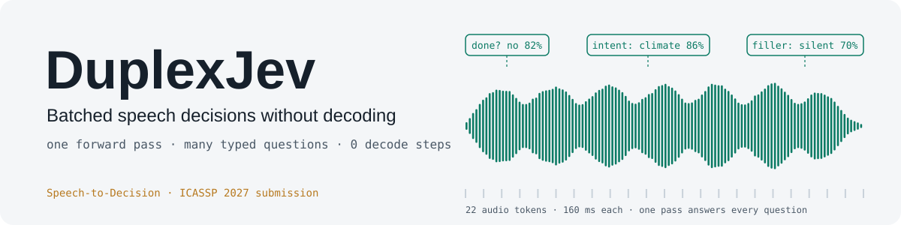
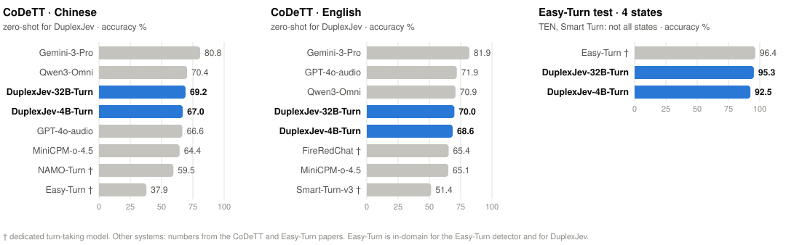

<p align="center">
  <picture>
    <source media="(prefers-color-scheme: dark)" srcset="docs/assets/banner_dark.svg">
    
  </picture>
</p>

<p align="center">
  <a href="README.md">English</a> &nbsp;|&nbsp; <b>中文</b>
</p>

<h1 align="center">不转写，直接判断。</h1>

<p align="center">
  <b>DuplexJev 是语音的 System One 模型（JEV 式决策模型）：原始音频进，带概率的判断出。语音智能体的耳朵。</b><br>
  用户说完了吗？我该不该停？他生气了吗？该接哪句垫词？<br>
  全部直接从原始语音读出，<b>一次前向</b>：<b>10 个判断 92 毫秒</b>，比 ASR → LLM 级联<b>快 21 倍</b>，
  <b>每百万次判断不到 0.5 美元</b>，新增一种判断只要<b>写一行文字</b>。<br>
  🏆 <b>副语言理解 SOTA</b>：在 <a href="https://arxiv.org/abs/2510.10444">LISTEN</a>、StressTest、MSPB 三个公开基准合计上，
  同一批题超过 <b>Gemini 3.8 Flash、Gemini 3.8 Live、GPT-realtime-2.1、GPT-audio-1.5 和 Qwen3-Omni</b>。<br>
  👁️ <b>它还看得见。</b><a href="https://huggingface.co/adventists-ai/DuplexJev-32B-Vision">DuplexJev-32B-Vision</a> 在同一次前向里把声音和画面对照着判断（预览版）——<a href="https://huggingface.co/spaces/BitKnight/DuplexJev-Vision">传张照片、录句话试试</a>。
</p>

<p align="center">
  <a href="https://api.adventists.cn/duplexjev/"></a>
  <a href="https://github.com/adventists-ai/duplexjev/stargazers"></a>
  <a href="integrations/pipecat"></a>
  <a href="integrations/livekit"></a>
</p>

<p align="center">
  <a href="https://arxiv.org/abs/2610.02638"></a>
  <a href="https://huggingface.co/adventists-ai"></a>
  <a href="https://www.modelscope.cn/organization/AdventistsAI"></a>
  <a href="https://pypi.org/project/duplexjev/"></a>
  <a href="https://huggingface.co/spaces/BitKnight/DuplexJev"></a>
  <a href="https://huggingface.co/spaces/BitKnight/DuplexJev-Vision"></a>
</p>

<p align="center"></p>
<p align="center"><sub>▶ <a href="docs/assets/duplexjev_launch_zh.mp4">看 2 分半中文介绍视频（有声音）</a> · 画面里的答案都是模型真实输出</sub></p>

## ⚡ 极速语音决策：一次前向，什么判断都能做

DuplexJev 把 Jev 带火的 System One（决策模型）思路用到了原始语音上：文本决策模型只能看转写，而语气、重音、迟疑恰恰在转写这一步丢了。

语音智能体在每次停顿时都要做判断。常规做法是先把语音转成文字，再让大模型写一段答案，每个问题生成一次。DuplexJev 直接听原始音频，
把你的**所有**问题当作选择题，在**一次前向**里一起回答，每题只读一个 token：不转写，也不解码文字。每个答案都带概率，可以直接当置信度用。

| | **DuplexJev** | ASR → LLM（同卡同模型） |
|---|:---:|---|
| 对一句话做十个判断（单张 H200） | **92 毫秒** | 1,978 毫秒 |
| 吞吐（每个请求都不超过 0.25 秒） | 单张 H200 **每秒约 170 个判断** | 每个问题一次生成 |
| 5k token 上下文上问 50 个问题 | **5.5 秒** | 111.5 秒 |
| 成本 | 4B 版**每百万次判断不到 0.5 美元** | |
| 新增一种判断 | **运行时加一行文字** | 重新采数据、重新训模型 |
| 硬件 | 4B **约 10 GB** · 32B 一张 80 GB 显卡 | |

**一段音频能判断什么：**

| | 判断 |
|---|---|
| 🔁 **对话流程** | 话轮状态（说完了、说到一半、只是附和、让对方等一下）· 真打断还是附和 · 不是对助手说的话 · 用户刚停顿时是否说完 |
| 💬 **说了什么** | 意图 · 该接哪句垫话 · 是否要转人工 · 任何关于内容的选择题（语音问答 90 分，同一大模型读文字稿 91 分） |
| 🎭 **怎么说的** | 情绪 · 重读了哪个词 · 停顿与断句 · 说话方式（耳语、大喊、快、慢）· 笑声、呼吸、咳嗽、叹气 |
| 🧑 **谁在说** | 性别 · 是不是同一个人 · 口音与方言区 · 语种 |
| 👁️ **看到了什么**（预览） | 声音和画面对照：重读词 vs 标红词 94.1，语气 vs 表情 93.5（只看图 50） |

**一段音频，八个判断。** 🔊 *"Wait, wait — stop. That's not the address I asked for."*（"等等——停，这不是我要去的地址。"助手正在说话时用户插进来；
[试听](docs/audio/ex1.wav)，合成语音）——DuplexJev-32B-Turn 一次调用，单张 H200 耗时 0.2 秒：

| 问题 | 答案 | 概率 |
|---|---|---:|
| 用户现在的话轮状态是？ | 让对方等一下 | 0.92 |
| 用户想做什么？ | 导航 | 1.00 |
| 先说哪句垫话？ | “稍等，” | 0.73 |
| 助手正在说话时听到这句，应该怎么做？ | 停下来听 | 1.00 |
| 说话人性别 | 男性 | 0.99 |
| 语言 | 英语 | 1.00 |
| 情绪 | 生气 | 1.00 |
| 助手自己能处理吗？ | 先向用户追问 | 0.51 |

<details>
<summary><b>每种能力一个例子：听出文字之外的信息</b></summary>

DuplexJev-32B-Stress 在短音频上的真实输出（vLLM，两种选项顺序取平均）；带播放器的同一组卡片见
[项目主页](https://adventists-ai.github.io/duplexjev/#abilities)。重音与断句的真人示例音频来自 MSPB（CC BY 4.0）。最后三行（Para 版）给的是评测分数，不是示例。

| 能力 | 判断什么 | 示例 → 模型回答（DuplexJev-32B-Stress） |
|---|---|---|
| 话轮状态 | 用户是说完了、话说到一半、只是附和，还是让助手等一下？靠语调和节奏判断，不只看文字。 | 🔊 [帮我导航到最近的充电站。](docs/audio/ex4.wav) → **说完了** 100%<br>🔊 [Could you turn the air conditioning down a little and, um —](docs/audio/ex3.wav) → **没说完** 99%<br>🔊 [Mm-hmm, yeah.](docs/audio/ex2.wav) → **只是附和** 100%<br>🔊 [等一下，我想想……](docs/audio/ex5.wav) → **让对方等一下** 100% |
| 说话时被插话 | 助手正在说话时，分清用户是真的要打断，还是只在附和：该停下来听，还是继续说。 | 🔊 [Wait, wait — stop. That's not the address I asked for.](docs/audio/ex1.wav) → **停下来听** 100%<br>🔊 [Mm-hmm, yeah.](docs/audio/ex2.wav) → **继续说** 100% |
| 不理会旁人的声音 | 旁边有人聊天、电视声或噪声，既不该让助手开口，也不该让它停下。 | 🔊 [哎你晚上吃什么？要不我们去吃火锅吧。——行啊，那我先订个位子。](docs/audio/ab_b1.wav) → **不出声，继续等（这不是对助手说的）** 100% |
| 情绪 | 中性、高兴、生气或伤心，从声音里听出来，而不是从文字里猜。 | 🔊 [Wait, wait — stop. That's not the address I asked for.](docs/audio/ex1.wav) → **生气** 100%<br>🔊 [太好了，谢谢你！](docs/audio/ex6.wav) → **高兴** 93%<br>🔊 [帮我导航到最近的充电站。](docs/audio/ex4.wav) → **中性** 100% |
| 说话人性别 | 听出说话人的性别——转写里没有这个信息。 | 🔊 [帮我导航到最近的充电站。](docs/audio/ex4.wav) → **男性** 100%<br>🔊 [太好了，谢谢你！](docs/audio/ex6.wav) → **女性** 100% |
| 重音（强调哪个词） 🆕 | 同样的字，重读不同的词，意思就不同。模型能听出重读落在哪个词上，也能判断“没有特别强调”。 | 🔊 [**张昊**昨晚做烤肉。](docs/audio/ab_m1.wav) → **张昊** 100%<br>🔊 [张昊**昨晚**做烤肉。](docs/audio/ab_m2.wav) → **昨晚** 100%<br>🔊 [张昊昨晚**做烤肉**。](docs/audio/ab_m3.wav) → **做烤肉** 97%<br>🔊 [我明天去北京开会。](docs/audio/ab_n0.wav) → **没有特别强调哪个词** 96% |
| 停顿与断句 🆕 | 在哪里停顿会改变句子结构：是一样东西还是两样，谁对谁做了什么。 | 🔊 [我买了巧克力雪糕｜和果汁。](docs/audio/ab_q1.wav) → **两样（巧克力雪糕、果汁）** 96%<br>🔊 [我买了巧克力｜雪糕｜和果汁。](docs/audio/ab_q2.wav) → **三样（巧克力、雪糕、果汁）** 98% |
| 非语言声音 🆕（Para） | 笑声、呼吸、咳嗽、叹气、吸鼻子、清嗓子、打喷嚏、哭声，带“都没有”选项。 | 训练没见过的真人语音（NonverbalTTS 测试集），笑 / 呼吸 / 咳嗽 / 叹气 AUC：32B-Para 0.88 / 0.81 / 0.85 / 0.80，4B-Para 0.80 / 0.76 / 0.75 / 0.81（之前 0.40–0.73；AudioSet AST 检测器 0.71–0.85）。 |
| 说话方式 🆕（Para） | 耳语、大喊、语速很快或很慢、音调特别高或特别低，还是正常说话。 | EARS 留出说话人 7 选 1：82%（32B-Para）/ 67%（4B-Para），之前 45–55%。 |
| 是谁在说 🆕（Para） | 给一段声音样本，判断是不是同一个人。像人一样的粗略判断，远不如专用说话人模型，不能用来识别身份。 | AISHELL-1 同性别配对：EER 18%（32B-Para）/ 9%（4B-Para）；官方 VoxCeleb1-H 列表：40% / 37%（专用 x-vector 模型约 2–4%）。 |

</details>

<details>
<summary><b>工作原理</b></summary>

**DuplexJev** 把一个冻结的语音大模型变成面向全双工语音智能体的**类型化判断引擎**（产品名 **Speech-to-Decision**）。
现成 ASR 编码器的隐状态经连接器送入冻结的大模型；运行时声明的每个问题——*用户说完了吗？先说哪句垫话？说话的是谁？*——
都读成**单个 token 上的闭集概率分布**：不做 ASR 解码，也不做文本解码。同一通电话的多个问题、乃至多通电话的问题，
可以在同一次前向计算里一起完成。所有发布的模型都可以直接用 vLLM 部署（[模型](#模型)）；推荐
**[DuplexJev-32B-Para](https://huggingface.co/adventists-ai/DuplexJev-32B-Para)**，显卡小用 **[DuplexJev-4B-Para](https://huggingface.co/adventists-ai/DuplexJev-4B-Para)**。

```
音频 ──► Qwen3-ASR-0.6B 编码器（冻结）
                 ▼  最后一层
          连接器：每 2 帧拼接 → 6.25 token/秒，MLP → d_LLM        ← 训练的部分（Turn 版另加大模型上的 rank 16 LoRA）
                 ▼
状态 + N 个类型化问题 ──► 冻结的大模型，一次前向
                          （DuplexJev-32B：Qwen3-VL-32B 的语言模型 · DuplexJev-4B：Qwen3-4B）
                 ▼
          p(A|q1) … p(D|q1),  …,  p(A|qN) … p(D|qN)      —— 0 步解码
```

- **类型化单 token 读出。** 每个问题的选项用打乱的字母标注，答案取下一个 token 在这些字母上的 softmax。输出一定合法，`max p` 可作置信度。
- **不只听懂字，还听得出人。** 只用转写蒸馏训练的语音大模型听不出性别和情绪；直接监督那一个答案 token，两者都能到 90% 左右，内容理解只变动约 1 分。
- **前缀共享。** 上下文和音频只编码一次，所有问题后缀打包进同一行、用块对角掩码隔开；答案与逐个运行一致（仅 bf16 数值误差）。

</details>

### 两种部署方式

| | 🏭 **多设备统一时间窗口**（商业场景推荐） | ⚡ **单路，按事件即时判断** |
|---|---|---|
| 怎么做 | 每个节拍（如 160–200 毫秒）服务端把所有在线设备或通话的最新音频收上来，一批前向回答全部问题 | 事件一发生就发请求（用户停顿、在助手说话时插话），立刻读出答案 |
| 好处 | 不用每路跑 ASR，也不用每个问题生成一次：很多设备共用一次前向，单次判断成本极低（8 个事件、80 个判断，8 卡节点 94–103 毫秒完成） | 不用等窗口边界：10 个判断 92 毫秒；4B 回答话轮题约 40–80 毫秒 |
| 适合 | 设备集群、车载助手、呼叫中心：流程状态、路由、监控、统计 | 实时语音助手的说完检测和插话判断（我们的 LiveKit、Pipecat 插件就是这样） |

两种方式可以混用：要求低延迟的判断按事件读，其余的按节拍读。无论哪种方式，一次前向都能回答你声明的所有问题，所以在用户一轮话结束时读一次，
就能同时定下话轮状态、生成回复期间该播哪句垫词、哪些内容值得记进记忆、这一轮回复需要调用哪些函数或工具，一轮出结果。

## 🏆 副语言理解 SOTA

副语言理解，指听出“话是怎么说的”，而不只是“说了什么”。三个公开基准合计：[LISTEN](https://arxiv.org/abs/2510.10444)
（EACL 2026，专门检验音频模型是在“听”还是只在“读字”）的四项纯音频测试、重音基准 StressTest 和韵律基准 MSPB，
共 1,035 道题，不含任何训练语料，所有模型回答的是同一批题。

| 模型 | **合计** | LISTEN 四项平均 | MSPB |
|---|---:|---:|---:|
| 🤗 **DuplexJev-32B-Para v1.3**（开源） | **50.2** | **34.5** | **77.3** |
| Gemini 3.8 Flash | 47.8 | 31.9 | 67.2 |
| Qwen3-Omni-30B | 45.0 | 32.5 | 71.9 |
| Gemini 3.1 Pro | 41.0 | 29.0 | 54.7 |
| GPT-audio-1.5 | 40.9 | 30.2 | 57.8 |
| Gemini 3.8 Live（实时） | 40.0 | 30.5 | 46.9 |
| GPT-realtime-2.1（实时） | 35.6 | 24.8 | 47.7 |

**领先多少：**

- **合计：**比 Gemini 3.8 Flash 高 2.4，比 Qwen3-Omni 高 5.2，比 Gemini 3.8 Live 高 10.2，比 GPT-realtime-2.1 高 14.6。
- **11 个语料里 8 个第一或并列第一**（对比 Gemini 3.8 Flash 和 Qwen3-Omni）。
- **从没听过的声音里，听出字面里没有的情绪**（LISTEN 中性文本，TESS）：**38.3**，Qwen3-Omni 25.5，Gemini 3.8 Flash 17.0。
- **完全没有字时的情绪**（LISTEN 笑声、叹气、呼吸，全集）：**28.1**，此前公开最好为 Qwen3-Omni 的 21.0。
- **韵律（MSPB）77.3**，七个模型里最高。
- **两家的实时旗舰都不如自家的离线模型**（Gemini 3.8 Live 低于 3.8 Flash，GPT-realtime-2.1 低于 GPT-audio-1.5），
  而实时听出语气，恰恰是语音智能体最需要的能力。

<sub>StressTest 上 Gemini 3.8 Flash 领先（89.0 对 86.5）；字面本身带情绪时通用模型更好（MELD 对话情绪：Qwen3-Omni 59.6，我们 38.5），
对话情绪数据已列入下一轮训练。感谢 Dipankar Sarkar 建议这样划分：LISTEN 里的 ESD、CREMA-D 题目在我们的训练数据中，不计入头条；
算上它们共 1,128 题，DuplexJev 为 50.9。逐项成绩、测试方法和每个模型的原始回答：[详细成绩](#与闭源模型对比含实时旗舰)、[`benchmarks/paraling_compare`](benchmarks/paraling_compare)。</sub>

## 🥇 分项成绩

在我们测过的大多数判断任务上，领先专用模型和闭源旗舰（同一行里所有模型答的是同一批题）：

| 任务 | 评测集 | **DuplexJev** | 次好 |
|---|---|---:|---|
| 重读的是哪个词，中 / 英 | 留出句† | **95.5 / 96.0** | 71.5 / 88.5 Gemini 3.8 Flash |
| 由重音判断意思 | DEBATE 留出句† | **93.0** | 79.5 Gemini 3.8 Flash |
| 从声音听情绪，四分类 | ESD + CREMA-D† | **92.0** | 46.0 Qwen3-Omni-30B |
| 说话方式（耳语、大喊、快……） | EARS 留出说话人† | **79.5** | 68.5 Gemini 3.1 Pro |
| 韵律 | MSPB | **77.3** | 71.9 Qwen3-Omni-30B |
| 情绪：字面中性 | LISTEN 全集 | **50.6** | 34.9 Gemini 2.5 Pro（公开成绩） |
| 笑 / 呼吸 / 咳嗽 / 叹气，AUC | NonverbalTTS 测试集（训练未见） | **0.88 / 0.81 / 0.85 / 0.80** | 0.71 / 0.75 / 0.85 / 0.76 AudioSet AST 检测器 |
| 话轮动作，零样本，中 / 英 | CoDeTT | **69.2 / 70.0** | 59.5 / 65.4 最好的专用话轮模型（NAMO-Turn / FireRedChat） |
| 实时话轮结束，14 种语言，300 毫秒 | LiveKit [eot-bench](https://github.com/livekit/eot-bench) | **14 种语言误打断全部少于 Smart Turn v3.2** | 英语 20.0% 对 35.2%，日语 14.1% 对 34.9% |
| 性别 | AISHELL-1、LibriSpeech | **93.8** | 只用转写训练的语音大模型约 55 |
| 声音 vs 画面（预览） | 留出合成测试集 | **94.1 / 93.5** | 只看图 50 |

<sub>† 测试集与我们的训练语料同源（说话人或句子不重叠），其他模型为零样本。完整表格见[详细成绩](#详细成绩)。</sub>

## 快速上手

**30 秒看到结果：**

```bash
pip install duplexjev
python -c "from duplexjev.remote import ApiClient; print(ApiClient('https://api.adventists.cn/duplexjev').decide('your.wav'))"
```

**自部署：**`vllm serve adventists-ai/DuplexJev-4B-Para`（约 10 GB 显存），配 `duplexjev-vllm` 插件（[快速上手](#快速上手)）·
**Pipecat：**`pip install pipecat-duplexjev` · **LiveKit Agents：**`pip install livekit-plugins-duplexjev`（[integrations/livekit](integrations/livekit)）：基于音频的话轮检测，同一次前向顺带给出情绪和非语言声音。

> 🏢 **要用在产品里？** AI降临派的全双工对话接口已服务 **300 多款 AI 硬件、10 万多台终端**。
> 呼叫中心、车载助手、智能硬件、语音 Agent 平台：权重为 CC BY-NC 4.0，我们提供**商用授权和托管的
> Speech-to-Decision API**。联系 **jiejin@adventists.ai**。

⭐ **点个星**关注后续能力：图像 + 语音联合判断、开源全双工管线都在路上。

**不需要显卡**——直接调我们的试用 API（有限流，不保存音频）：

```bash
pip install duplexjev
duplexjev quick call_zh.wav --api https://api.adventists.cn/duplexjev --lang zh
```

```
判断       答案                置信度
-----------------------------------------
话轮状态   话说完了，可以接话  0.87
该怎么做   马上回应            0.91
...
8 个判断，80 ms
```

换成自己的题目：`--questions table.json`（`{"id", "text", "options"}` 的列表），或在 Python 里
`quick("call.wav", lang="zh", questions=[Question("product", "用户在问哪个产品？", ["手机", "电脑", "其他"], lang="zh")])`。
带录音功能的网页版在 [api.adventists.cn/duplexjev](https://api.adventists.cn/duplexjev/)。

**用自己的显卡**，vLLM 部署：

```bash
pip install "vllm[audio]>=0.29" duplexjev-vllm
vllm serve adventists-ai/DuplexJev-4B-Para --max-model-len 4096   # 大显卡换成 adventists-ai/DuplexJev-32B-Para
duplexjev quick call.wav --vllm http://localhost:8000/v1 --lang zh   # 用默认判断表问自己的服务
duplexjev gateway --vllm http://localhost:8000/v1 --port 8020        # 在前面套上这个网页 demo 和 HTTP API
```

也可以在 Python 里问自己的问题（OpenAI 兼容接口；每个问题一个请求，`max_tokens=1`）：

```python
from vllm_client import DuplexJevClient      # examples/vllm_client.py：只依赖 openai 和标准库

dj = DuplexJevClient("http://localhost:8000/v1")
dj.decide(open("call_018.wav", "rb").read(), {
    "turn":    ("用户说完了吗？", ["说完了", "还没说完"]),
    "gender":  ("说话人的性别是？", ["男性", "女性"]),
    "emotion": ("说话人当时的情绪状态是？", ["中性", "高兴", "生气", "伤心"]),
}, lang="zh")
# {'turn': {'answer': '说完了', 'confidence': 0.9, 'probs': {...}}, 'gender': {...}, 'emotion': {...}}
```

同一段音频的多个问题并发发送，在 vLLM 的前缀缓存里共用音频部分。用音频的语言提问（中文语音用中文问题和选项）。
提示词格式和插件说明见[模型卡](https://huggingface.co/adventists-ai/DuplexJev-32B-Para)和 [`vllm_plugin/`](vllm_plugin)。
想用 PyTorch 包加载连接器 checkpoint，见 [docs/connectors_zh.md](docs/connectors_zh.md#pytorch-包)。

### 使用新能力

用 Para 模型（`vllm serve adventists-ai/DuplexJev-4B-Para`，或本地 `pip install "duplexjev[speech]"`）时，`duplexjev quick`
的默认判断表多了两行：*非语言声音* 和 *说话方式*。也可以直接问（下面是模型训练时用的问法；记得保留“没有 / 都没有”选项）：

```python
dj.decide(clip_zh, {
    "sound":  ("除了说话，这段音频里还有哪种声音？", ["笑声", "呼吸声", "咳嗽", "叹气", "都没有"]),
    "laugh":  ("这段话里有没有笑声？", ["有", "没有"]),
    "style":  ("说话人是用什么方式在说话？", ["小声耳语", "大声喊着说", "正常音量说话"]),
    "stress": ("说话人是否重读（强调）了某个词？", ["张昊", "昨晚", "做烤肉", "没有强调任何词"]),
}, lang="zh")
```

是不是同一个人：把一段声音样本和新的语音拼成一个文件，中间隔约 0.8 秒静音，问
`"静音前是某人的一段声音样本，静音后是另一段语音。两段是同一个人吗？"`，选项 `["是不同的人", "是同一个人"]`
（英文：`"Before the silence is a voice sample of someone; after it is another clip. Are they the same speaker?"`，`["different speakers", "same speaker"]`）。
现成脚本：[`examples/para_abilities.py`](examples/para_abilities.py)。

### 声音 + 画面联合判断（研究预览）

[DuplexJev-32B-Vision](https://huggingface.co/adventists-ai/DuplexJev-32B-Vision) 把 Qwen3-VL 的视觉编码器接回
DuplexJev-32B-Para 的语言模型前面，同一道题可以同时用上**听到的**和**看到的**（单张 80 GB 显卡）。浏览器里直接试：[DuplexJev-Vision Space](https://huggingface.co/spaces/BitKnight/DuplexJev-Vision)。

```python
# pip install "duplexjev[vision]>=0.5"
from duplexjev.vision import VisionDecider
vd = VisionDecider.from_pretrained("adventists-ai/DuplexJev-32B-Vision")
vd.decide(audio="clip.wav", image="face.jpg", questions=[
    {"id": "match", "text": "Does the face in the picture show the same emotion as the speaker's voice?", "options": ["Yes", "No"]}])
vd.chat(image="photo.jpg", text="图片里写了什么？")
```

也可以用 vLLM 部署（`pip install "duplexjev-vllm>=0.3"`），一张图配 3 秒语音，每道题约 0.05 秒：

```bash
vllm serve adventists-ai/DuplexJev-32B-Vision --max-model-len 8192 --limit-mm-per-prompt '{"image": 1, "audio": 1, "video": 0}'
python examples/vllm_vision_client.py clip.wav face.jpg
```

留出集成绩：重读词 vs 标红词 94.1，表情 vs 语气 93.5，声音 vs 文字说明 97.5（只给图：50）；没见过的说话人的真实照片配他们自己的声音 64.4，其中开心的声音 81.7。真实照片的案例见[项目主页](https://adventists-ai.github.io/duplexjev/#ab-vision)。

## 模型

主推四个模型，每个都是**一个包含全部组件的仓库**（音频编码器 + 连接器 + 大模型），装一个小插件就能用
[vLLM](https://github.com/vllm-project/vllm) 部署（见[快速上手](#快速上手)）。提示词和插件都一样。

| 模型 | 适用 | 显存 | 亮点 |
|---|---|---|---|
| ⭐ 🤗 [**DuplexJev-32B-Para**](https://huggingface.co/adventists-ai/DuplexJev-32B-Para) v1.4 | **综合最好**：能力最全，新增日语、韩语、越南语、泰语、阿拉伯语、俄语，实时话轮最好 | 一张 80 GB 显卡 | FLEURS 错误率 日 / 韩 11.6 / 7.6%（v1.3：32.7 / 31.8）· 对话日语 11.1% |
| ⭐ 🤗 [**DuplexJev-4B-Para**](https://huggingface.co/adventists-ai/DuplexJev-4B-Para) v1.3 | **小显卡**，能力最全，还能正常聊天；日语接近中英文水平；`duplexjev` 默认模型 | 约 10 GB | FLEURS 日语错误率 17.2%（v1.2：35.8，v1.1：59.6）· 对话日语 13.1% |
| 🤗 [**DuplexJev-4B-Para-LiveTurn**](https://huggingface.co/adventists-ai/DuplexJev-4B-Para-LiveTurn) | 小显卡，给 LiveKit / Pipecat 语音 agent 做**实时话轮判断** | 约 10 GB | eot-bench 300 毫秒误打断：英 **25.5%** / 中 **38.8%**（Smart Turn v3.2：35.2 / 42.9） |
| 🤗 [**DuplexJev-32B-Vision**](https://huggingface.co/adventists-ai/DuplexJev-32B-Vision)（预览） | **声音 + 画面**一起判断 | 一张 80 GB 显卡 | 重读词 vs 标红词 94.1 · 表情 vs 语气 93.5（只看图 50）· [试一试](https://huggingface.co/spaces/BitKnight/DuplexJev-Vision) |

全部在[魔搭 ModelScope](https://www.modelscope.cn/organization/AdventistsAI) 有同名镜像（权重相同）：
`modelscope download --model AdventistsAI/DuplexJev-32B-Para --local_dir ./DuplexJev-32B-Para`，然后 `vllm serve ./DuplexJev-32B-Para`。
权重为 CC BY-NC 4.0；商用授权：jiejin@adventists.ai。

**各版本成绩、版本间对比、专项和归档模型**（Stress、Turn、Gemma-31B）以及研究用连接器 checkpoint：**[docs/models_zh.md](docs/models_zh.md)**。

## 最新动态

- **2026-10-22** · 🤗 [**DuplexJev-32B-Para v1.4**](https://huggingface.co/adventists-ai/DuplexJev-32B-Para) 和 [**DuplexJev-4B-Para v1.3**](https://huggingface.co/adventists-ai/DuplexJev-4B-Para)：日语成为第三语言（FLEURS 错误率 32B 32.7 → 11.6%，4B 35.8 → 17.2%；对话日语 11.1% / 13.1%）；32B 的韩语 31.8 → 7.6%、越南语 41.7 → 14.6%，中文副语言也明显提升。旧版本仍可按 revision 使用。[发布说明](research/2026-10-japanese_zh.md)。
- **2026-10-21** · 🤗 [**DuplexJev-4B-Para v1.2**](https://huggingface.co/adventists-ai/DuplexJev-4B-Para)：能听懂日语、韩语、越南语、泰语（FLEURS 错误率 日语 59.6 → 35.8%，韩语 61.5 → 20.3%）；中文副语言大幅提升（喘气、咂嘴、笑声、吸鼻子、重读词，在留出说话人上从 57–65% 升到 81–95%）。公开副语言基准合计基本不变（47.6，v1.1 47.8）。[发布说明](research/2026-10-weak-languages_zh.md)。
- **2026-10-15** · 🤗 [**DuplexJev-32B-Para v1.3**](https://huggingface.co/adventists-ai/DuplexJev-32B-Para)：听重音大幅提升（StressTest 71.5 → 86.5，MSPB 68.0 → 77.3）。公开副语言基准合计 **50.2**，Gemini 3.8 Flash 47.8。
- **2026-10-15** · 🏆 用同一批题测了实时旗舰（Gemini 3.8 Live、GPT-realtime-2.1）和 GPT-audio-1.5；LiveKit eot-bench 补齐全部 14 种语言。
- **2026-10-14** · 🤗 [**DuplexJev-4B-Para-LiveTurn**](https://huggingface.co/adventists-ai/DuplexJev-4B-Para-LiveTurn)：约 10 GB 显卡上的实时话轮判断。
- **即将推出：**开源全双工 Jev 对话流水线。

全部发布记录：[docs/news_zh.md](docs/news_zh.md)。

## 详细成绩

### 与闭源模型对比（含实时旗舰）

仍是同一批题（每项 200 题，集合较小时 107–174 题）。每个模型每题问一次，选项按原顺序，
取回复里的第一个选项字母：`gemini-3.1-pro-preview`、`gemini-3.8-flash`（默认思考设置），`gpt-audio-1.5`（chat 接口音频输入），
以及两家的实时旗舰，走各自的实时接口：`gemini-3.8-live`（先发题目，再在一段手动 activity 里流式发送音频；它只能用语音回答，
我们读它的输出转写）和 `gpt-realtime-2.1`（websocket 会话，文本输出，音频和题目放在同一条用户消息里，关闭 VAD）。

| 测试 | DuplexJev-32B-Para v1.3 | Qwen3-Omni-30B | Gemini 3.1 Pro | Gemini 3.8 Flash | Gemini 3.8 Live | GPT-audio-1.5 | GPT-realtime-2.1 |
|---|---:|---:|---:|---:|---:|---:|---:|
| **公开基准合计**（LISTEN 四项、StressTest、MSPB，1,035 题，不含训练语料） | **50.2** | 45.0 | 41.0 | 47.8 | 40.0 | 40.9 | 35.6 |
| ……算上 LISTEN 的 ESD、CREMA-D 题（1,128 题） | **50.9** | 44.6 | 40.1 | 46.9 | 38.9 | 40.1 | 34.2 |
| **LISTEN 纯音频四项平均**（不含训练语料） | **34.5** | 32.5 | 29.0 | 31.9 | 30.5 | 30.2 | 24.8 |
| LISTEN 字面中性 | **43.0** | 33.5 | 25.0 | 31.0 | 25.0 | 24.5 | 15.5 |
| ……只算训练没见过的语料（TESS、SAVEE、RAVDESS） | **29.9** | 28.0 | 20.6 | 26.2 | 23.4 | 18.7 | 12.1 |
| LISTEN 完全没有字 | **26.0** | 18.0 | 15.5 | 19.5 | 14.5 | **25.0** | 13.5 |
| LISTEN 字面是反讽 | **44.0** | 41.5 | 42.5 | 42.0 | 42.5 | 41.5 | 38.5 |
| LISTEN 字面与语气一致 | 38.0 | **42.5** | 37.5 | 40.0 | 41.5 | 35.5 | 35.0 |
| 情绪 ESD + CREMA-D† | **92.0** | 46.0 | 32.5 | 40.5 | 27.5 | 35.0 | 31.5 |
| 哪个词重读，中 / 英† | **95.5 / 96.0** | 62.0 / 73.6 | 58.5 / 52.9 | 71.5 / 88.5 | 43.0 / 56.9 | 28.0 / 42.0 | 14.0 / 30.5 |
| 由重音判断意思 DEBATE† | **93.0** | 36.5 | 51.5 | 79.5 | 55.0 | 27.5 | 26.0 |
| StressTest | 86.5 | 70.0 | 70.5 | **89.0** | 66.0 | 62.5 | 60.0 |
| 说话方式 EARS† | **79.5** | 51.0 | 68.5 | 45.0 | 56.5 | 54.0 | 48.0 |
| MSPB（陈述 / 疑问等） | **77.3** | 71.9 | 54.7 | 67.2 | 46.9 | 57.8 | 47.7 |

† 测试集与我们的训练语料同源（说话人或句子不重叠），其他模型都是零样本。其余各行是公开基准；LISTEN 的语料里只有 ESD、CREMA-D 在我们的情绪训练数据中。

六个公开基准合计（不含任何训练语料的题目），v1.3 为 50.2，其他模型最好的 Gemini 3.8 Flash 为 47.8，Qwen3-Omni 为 45.0；MSPB 和 LISTEN 上 v1.3 领先，StressTest 上 Gemini 3.8 Flash 领先（89.0 对 86.5）。LISTEN 纯音频四项平均，DuplexJev 全集 38.9（这批题 37.8），超过所有已公开和我们测过的模型，包括闭源的实时旗舰：在 LISTEN 上副语言理解 SOTA。
领先最多的是听出字面里没有的情绪；LISTEN 中性文本全集上 50.6，此前公开最好成绩是 Gemini 2.5 Pro 的 34.9（LISTEN 论文）。
实时模型都不如同家的离线模型（Gemini 3.8 Live 低于 3.8 Flash，GPT-realtime-2.1 低于 GPT-audio-1.5）。两个 GPT 模型和
Gemini 3.8 Live 对情绪题大多回答“中性”（GPT-realtime-2.1 在 200 道字面中性题里答了 150 次 neutral）；我们按原样计分，
不清楚这是产品上的有意设计，还是确实听不出来。Gemini 3.8 Flash 在 StressTest 上领先；字面本身带情绪时，通用模型领先。答不出选项字母记为错（GPT-audio-1.5 约 2%，
Gemini 3.8 Live 0.5%，其他约 0）。脚本、题目列表和每个模型的原始回答：[`benchmarks/paraling_compare`](benchmarks/paraling_compare)。

**打乱选项顺序**（每道 4 选 1 题的 24 种顺序全部测，共 33,508 次请求）：答案改变的比例是 3.3%，全部出现在模型本来就不确定的题上（答案概率 ≥ 0.8 的题只有 0.01%）；没有偏向某个字母位置，单一顺序的准确率和多种顺序平均后一样。详见 [`benchmarks/option_order`](benchmarks/option_order)。

### 实时话轮检测：LiveKit eot-bench 与 Pipecat Smart Turn

这两个榜考的是实时对话里最难的一刻：用户**刚**停下来，是说完了，还是只是停顿？

| 模型 | eot-bench 英文：最多等 300 / 600 ms 的误打断 | eot-bench 中文 | Smart Turn v3.2 测试集准确率 英 / 中 |
|---|---:|---:|---:|
| LiveKit Turn Detector v1 | 9.9 / 4.5% | 20.6 / 8.7% | – |
| **DuplexJev-32B-Para v1.2**，带助手上一句话（插件设置） | **20.0 / 9.4%** | **37.7 / 12.2%** | – |
| **DuplexJev-32B-Para v1.2**，只用音频 | 23.5 / 11.1% | 40.0 / 12.8% | **94.0 / 91.1**° |
| **DuplexJev-4B-Para-LiveTurn**（约 10 GB），带助手上一句话（插件设置） | **25.5 / 12.3%** | **38.8 / 12.0%** | **93.3 / 89.6**° |
| Smart Turn v3.2 | 35.2 / 14.8% | 42.9 / 13.2% | 94.7 / 90.5 |

- eot-bench：验证集，在每个停顿的第 0.2 秒做判断，用官方 `compute-metrics` / `compare-models` 计分；它的音频不在我们的
  训练数据里。其他行取自 eot-bench 仓库。“带上一句话”那行是 eot-bench 完整模式、插件同设置：音频前加 `The assistant had just said: "..."`（新版插件会自动带上），
  得分取 P(说完) + P(附和)。“只用音频”的 DuplexJev 各行用快速模式（每个停顿只在第 0.2 秒问一次）。
- ° Smart Turn v3.2 的**训练集**在 v1.2 的训练数据里，所以这一列对 v1.2 是同分布成绩（对 Smart Turn 自己也是）。
- **eot-bench 全部 14 种语言**（DuplexJev-32B-Para v1.2，带助手上一句话，完整运行；只训练过中英文，其他 12 种语言用英文提问）。300 / 600 毫秒预算下的误打断率：

  | | ar | de | es | fr | hi | id | it | ja | ko | nl | pt | tr |
  |---|---:|---:|---:|---:|---:|---:|---:|---:|---:|---:|---:|---:|
  | DuplexJev-32B-Para v1.2 | **34.7** / **11.5** | **21.3** / **8.3** | **33.4** / **13.6** | **23.1** / **9.1** | **29.7** / **5.3** | **31.9** / **14.0** | **28.6** / **10.9** | **14.1** / **3.7** | **23.8** / 9.7 | **25.3** / **10.5** | **32.5** / **10.8** | **29.8** / **13.2** |
  | Smart Turn v3.2 | 39.2 / 13.2 | 35.5 / 14.2 | 38.7 / 17.3 | 38.9 / 10.6 | 42.6 / 6.5 | 46.2 / 15.9 | 44.1 / 15.2 | 34.9 / 11.2 | 30.1 / 9.7 | 42.3 / 13.4 | 42.7 / 13.1 | 43.3 / 17.9 |
  | LiveKit Turn Detector v1 | 16.2 / 6.9 | 11.8 / 5.7 | 15.5 / 6.0 | 12.7 / 5.4 | 10.5 / 2.0 | 22.3 / 8.8 | 16.9 / 7.9 | 5.6 / 1.3 | 5.5 / 2.1 | 12.5 / 5.1 | 20.1 / 7.3 | 15.7 / 6.9 |

  加粗：误打断少于 Smart Turn v3.2。LiveKit 自家的检测器在所有语言上都领先。
- 复现代码：[`benchmarks/turn_detection/`](benchmarks/turn_detection)；带上一句话那行用
  [`eot_bench/duplexjev_ctx_adapter.py`](benchmarks/turn_detection/eot_bench/duplexjev_ctx_adapter.py)。

> **想测出上表的成绩，请这样跑。** 这些数来自 **DuplexJev-32B-Para v1.2**。从 2026-10-13 起免费试用 API 也换成了这个模型，
> 插件默认就能用上；但试用 API 有限流（每分钟 30 次）、服务器在国内，实时 agent 和跑分建议自己部署：
>
> ```bash
> pip install "vllm[audio]>=0.29" duplexjev-vllm "duplexjev[server]>=0.6"
> vllm serve adventists-ai/DuplexJev-32B-Para --revision v1.2 --max-model-len 4096 --port 8000 &   # 一张 80 GB 卡
> duplexjev gateway --vllm http://localhost:8000/v1 --port 8420 --rate 1000000
> ```
>
> 然后把插件指向它（`api_url=` / `url="http://localhost:8420"`），保持默认的 `readout="turn"`，并把助手上一句话交给插件
> （LiveKit 用 `detector.attach(session)`，Pipecat 用 `DuplexJevContextTracker`）。不给助手上一句话，成绩对应“只用音频”那行。
> eot-bench 完整命令见 [`benchmarks/turn_detection/README.md`](benchmarks/turn_detection/README.md)。

### 速度与口语问答

| | DuplexJev-32B(-Turn) | DuplexJev-4B(-Turn) |
|---|---|---|
| 一次判断（同一段音频 10 个问题，作为 10 个并发请求发给 vLLM OpenAI 服务） | 单张 H200 中位 **240 毫秒** | 默认 8 个问题约 **80 毫秒**（单张 H100，我们的试用 API） |
| 显存 | 一张 80 GB 显卡 | 约 10 GB |
| 口语知识问答 VoiceBench OBQA / MMSU（语音输入） | **83.7 / 70.8** | 47.3 / 41.3 |

作为参照，同一个大模型直接读文字是 95.4 / 79.3（Qwen3-VL-32B）。和常见的级联做法（先转写，再让大模型生成 JSON）相比，
单 token 读出完成 10 个判断要 92 毫秒，级联要 1,567 毫秒另加 ASR 411 毫秒（论文测量：Qwen3-32B、单张 H200、vLLM，10 个问题打包成一个请求）。
完整表格见 [docs/paper_results.md](docs/paper_results.md)。

<details>
<summary><b>话轮判断：对比专用检测器</b>（Easy-Turn、CoDeTT）</summary>

以下用 DuplexJev-32B-Turn 测得，它是 Para 版的话轮基础（32B-Para v1.3：Easy-Turn 94.4）。它的话轮判断达到专用检测器的水平；同一次前向里，它还能回答你声明的其他任意问题（意图、情绪、性别、
是否打断……）。全程不解码，同一段音频问 10 个问题和问 1 个的耗时差不多。

| 模型 | Easy-Turn 测试集（说完 / 没说完 / 附和 / 等一下） | Easy-Turn 总体 | CoDeTT 中 / 英 | 同一次调用的其他判断 | 延迟 |
|---|---|---:|---:|---|---|
| Smart Turn v2（95 MB） | 78.7 / 62.0 / – / – | – | – / 51.4（v3） | 无 | 27 ms |
| TEN Turn Detection（7 B） | 86.7 / 89.3 / – / 91.0 | – | – | 无 | 204 ms |
| Easy-Turn（0.85 B） | 96.3 / 97.7 / 91.0 / 98.0 | 96.4 | 37.9 / – | 无 | 263 ms |
| NAMO-Turn · FireRedChat | – | – | 59.5 / – · – / 65.4 | 无 | – |
| GPT-4o-audio · Qwen3-Omni | – | – | 66.6 / 71.9 · 70.4 / 70.9 | 有（靠生成文字） | 秒级 |
| **DuplexJev-32B-Turn**（本项目） | **98.7** / 94.3 / 88.0 / 95.0 | **95.3** | **69.2 / 70.0** | **有，任意多个，一次前向** | **10 个判断约 0.24 s**（单张 H200） |
| DuplexJev-4B-Turn（本项目） | 92.3 / 93.0 / 90.0 / 94.0 | 92.5 | 67.0 / 68.6 | 有 | 8 个判断约 0.08 s（单张 H100） |

- **Easy-Turn**：800 条测试集的准确率（%）。Easy-Turn 本身和我们的 Turn 模型都用过它的训练集。其他行取自 Easy-Turn
  论文（表 2，他们的硬件），延迟是单个判断的耗时。
- **CoDeTT**（[arXiv:2603.25434](https://arxiv.org/abs/2603.25434)）：1.8 万条，系统状态已知，4 个动作准确率平均。
  对我们是零样本（训练中没有 CoDeTT 数据）；其他行取自 CoDeTT 论文。我们的口径只给当前这句的音频、不给历史，
  官方口径还会播放之前的用户语音。
- 在我们自建的 TurnBench-dev 片段协议上（非官方榜单），Turn 模型 88.7（32B）/ 87.3（4B），升级前为 60.7 / 49.4。
- **其他能力没有变差。** 32B：qa100 90 → 96，性别 89.4 → 91.5，情绪 90.6 → 91.1，VoiceBench MMSU 70.8 → 72.1。
  做法（只用公开数据、一个 rank 16 的 LoRA，4B 和 32B 同一配方）见[研究笔记](research/2026-10-turn-taking-lora_zh.md)。

<p align="center">
  <picture>
    <source media="(prefers-color-scheme: dark)" srcset="docs/assets/bench_turn_dark.svg">
    
  </picture>
</p>

</details>

<details>
<summary><b>常见判断任务：对比专用模型</b>（性别、情绪、说话人、非语言声音、口语问答）</summary>

| 任务 | 评测集 | DuplexJev | 专用模型和其他模型 |
|---|---|---:|---|
| 话轮状态：说完 / 没说完 / 附和 / 等一下 | Easy-Turn 测试集（800） | **95.3** | Easy-Turn 检测器 96.4 · TEN Turn Detection、Smart Turn v2 只覆盖 4 类中的 3 / 2 类 |
| 已知系统状态，该怎么做 | CoDeTT 中 / 英（1.8 万，零样本） | **69.2 / 70.0** | Easy-Turn 37.9（中）· Smart-Turn-v3 51.4（英）· NAMO-Turn 59.5（中）· FireRedChat 65.4（英）· GPT-4o-audio 66.6 / 71.9 · Qwen3-Omni 70.4 / 70.9 · Gemini-3-Pro 80.8 / 81.9 |
| 性别 | 800 条真实语音（AISHELL-1、LibriSpeech） | **91.5** | 只用转写训练的语音大模型：约 55（瞎猜） |
| 情绪（4 类） | 800 条（ESD、CREMA-D） | **91.1** | 只用转写训练的语音大模型：约 28（瞎猜）· Qwen3-Omni-30B 45.2（同题，其中 400 条）† |
| 情绪：字面中性 | LISTEN 中性文本，只给音频（TESS、SAVEE、RAVDESS、ESD、CREMA-D） | **50.6**（v1.3，全部 4,286 题；v1.2 在对比的 400 题上 50.7） | Qwen3-Omni-30B 32.8（同样的 400 题）· 论文：Gemini 2.5 Pro 34.9、Qwen3-Omni 29.3 |
| 情绪：完全没有字 | LISTEN 副语言（IEMOCAP 笑、叹气、呼吸） | **28.1**（v1.3，全部 975 题；v1.2 在对比的 400 题上 26.0） | Qwen3-Omni-30B 18.2（同样的 400 题）· 论文：Qwen3-Omni 21.0、Gemini 2.5 Pro 15.7 |
| 是不是同一个人 | 官方 VoxCeleb1-H 列表：不同人之间性别和国籍相同（2,000 个试次） | **EER 36.9%**（4B-Para）/ 40.3%（32B-Para）；研究 checkpoint‡ 29.6% / 31.2% | 只靠性别：瞎猜（50）；专用说话人模型（ECAPA-TDNN）：EER 约 2% |
| 笑 / 呼吸 / 咳嗽 / 叹气 | NonverbalTTS 测试集（真人语音，训练未见），AUC | **0.88 / 0.81 / 0.85 / 0.80**（32B-Para） | AudioSet AST 检测器 0.71 / 0.75 / 0.85 / 0.76 |
| 口语知识问答 | VoiceBench OBQA / MMSU | **85.5 / 72.1** | 同一大模型直接读文字：95.4 / 79.3 |

其他系统的数字取自各自论文（Easy-Turn 表 2、CoDeTT、Dynamic-SUPERB Phase-2）。Easy-Turn 对 Easy-Turn 检测器和我们的模型都是域内评测。
‡ 研究 checkpoint：只训练说话人验证（训练数据不含 VoxCeleb1 说话人），未发布；Para 版为了保住其他各项能力，在这一项上让了一些分，详见[研究笔记](research/2026-10-speaker-identity_zh.md)。随机配对里约一半的"不同人"性别也不同，只靠性别猜就能到 74%，所以只报困难配对。

</details>

各版本成绩，以及更早与 Qwen3-Omni 在更多题目上的一对一对比：[docs/models_zh.md](docs/models_zh.md)。

## 评测基准

| 基准 | 任务 | 条数 | 链接 |
|---|---|---:|---|
| qa100 | 语音选择题，合成语音（中 + 英） | 100 | 🤗 [adventists-ai/qa100](https://huggingface.co/datasets/adventists-ai/qa100) |
| ZJU-ML | 浙大音频基准 v2.0.0 主语言部分：语音提问，一半为真人录音 | 100 | [GitHub](https://github.com/Vsky-morigen/audio-gender-benchmark) |
| Easy-Turn | 四类话轮状态（说完 / 没说完 / 附和 / 等一下）；完整模型用过它的训练集 | 800 | Easy-Turn 测试集（[arXiv:2509.23938](https://arxiv.org/abs/2509.23938)） |
| 性别 | 说话人性别，真人录音（AISHELL-1、Common Voice、LibriSpeech），中 + 英 | 800 | [`evaluation/`](evaluation) |
| 情绪 | 中性 / 高兴 / 生气 / 伤心，表演语音（ESD、CREMA-D），中 + 英 | 800 | [`evaluation/`](evaluation) |

**主语言** = qa100、ZJU-ML、Easy-Turn 三项平均；**副语言** = 性别、情绪两项平均；**总分** = 两者平均。
随机水平：四选一任务 25%，性别 50%。[连接器排行榜](docs/connectors_zh.md#排行榜)由 [`evaluation/build_leaderboard.py`](evaluation/build_leaderboard.py)
根据同目录下的结果文件生成。

## 训练

编码器和大模型都冻结，只训练连接器；训练框架为打过补丁的 [Ultravox](https://github.com/fixie-ai/ultravox)。
两个完整模型都按同样的三步训练：

1. **内容，R1 和 R2。** 在 Ultravox v0.6 数据混合（WenetSpeech、GigaSpeech、Common Voice、CoVoST 2、People's Speech、
   LibriSpeech、MLS、MUSAN）上做转写蒸馏；数据切成 100 个互不重叠的包，R1、R2 各用一包。
2. **判断。** 在读出位置对单个选项字母做交叉熵：话轮状态（Easy-Turn 训练集）、性别（AISHELL-1、LibriSpeech）、
   情绪（ESD、CREMA-D）。
3. **混合训练。** 从 R2 出发，内容和判断样本一起训练（内容做蒸馏，判断做答案 token 交叉熵）；4,000 步，学习率 1e-4，
   内容样本加权（×10）、性别和情绪降权（×0.5），在学会话轮、性别、情绪的同时保住内容理解。

配方、数据链接和脚本：[`training/`](training)。情绪语料不再分发。[docs/connectors_zh.md](docs/connectors_zh.md) 里的研究用
checkpoint 用的是这套配方的早期版本。

## 仓库结构

| 路径 | 内容 |
|---|---|
| [`vllm_plugin/`](vllm_plugin) | `duplexjev-vllm`：部署 DuplexJev-32B、DuplexJev-4B 和 DuplexJev-Gemma-31B 的 vLLM 插件 |
| [`duplexjev/`](duplexjev) | `duplexjev` 包：`quick()` 和默认判断表、vLLM 与 API 客户端、网页 demo 网关；加载连接器 checkpoint 的 PyTorch `Decider` |
| [`examples/`](examples) | [vLLM 客户端](examples/vllm_client.py)、快速上手、服务客户端 |
| [`evaluation/`](evaluation) | 评测脚本和结果 |
| [`training/`](training) | Ultravox 配置和补丁、数据配方、100 包切分、编码器移植 |
| [`research/`](research) | 研究笔记：实验和设计取舍，附数字和误差范围 |
| [`docs/`](docs) | 项目主页、[连接器 checkpoint](docs/connectors_zh.md)、[论文结果](docs/paper_results.md)、[包的细节](docs/package.md) |
| [`duplexjev/research/`](duplexjev/research)、[`tests/`](tests)、[`benchmarks/`](benchmarks) | 论文代码（读出、问题约定、融合编码器）、等价性测试、延迟和容量实验 |

论文代码里还留有我们集群上的路径，见 [docs/PATHS.md](docs/PATHS.md)。

## 许可

代码：Apache-2.0（[LICENSE](LICENSE)）。完整模型（DuplexJev-32B、DuplexJev-4B、DuplexJev-Gemma-31B）：CC BY-NC 4.0，因为其中的连接器用情绪数据训练过。连接器权重：Apache-2.0；用情绪数据训练的（`-Emotion-` 和 `-Para-`）为 CC BY-NC 4.0，
因为 ESD 仅限研究使用。qa100：CC-BY-4.0。冻结的编码器和大模型沿用各自的许可（Falcon-H1：TII Falcon License；
SenseVoice：FunASR Model License）。部分训练语料（如 WenetSpeech、CoVoST 2）有非商用条款。详见 [NOTICE](NOTICE)。

## 引用

```bibtex
@misc{jin2026duplexjev,
  title         = {Batched Speech Decisions Without Decoding: Single-Token Supervision Lets a Frozen {LLM} Hear Beyond the Transcript},
  author        = {Jin, Jie and Ma, Ziyin and Yin, Min and Chen, Jinyu and Song, Haigang and Pang, Zhikun and Zhang, Xiaowen},
  year          = {2026},
  eprint        = {2610.02638},
  archivePrefix = {arXiv},
  note          = {Submitted to IEEE ICASSP 2027}
}
```

## 致谢

DuplexJev-32B 和 DuplexJev-4B 基于 [Qwen3-VL](https://github.com/QwenLM/Qwen3-VL)、[Qwen3](https://github.com/QwenLM/Qwen3)
和 Qwen3-ASR（DuplexJev-Gemma-31B 基于 [Gemma 4](https://huggingface.co/google/gemma-4-31B-it)），用 [Ultravox](https://github.com/fixie-ai/ultravox) 训练，用 [vLLM](https://github.com/vllm-project/vllm) 部署。
研究用 checkpoint 还用到 [MOSS-Transcribe-Diarize](https://huggingface.co/OpenMOSS-Team/MOSS-Transcribe-Diarize)、Whisper、
SenseVoice、SmolLM3 和 Falcon-H1。感谢浙大团队提供[音频基准](https://github.com/Vsky-morigen/audio-gender-benchmark)。
Claude（Anthropic）协助编写代码。
问题和建议：[GitHub Issues](https://github.com/adventists-ai/duplexjev/issues)。DuplexJev 是独立项目，与 TypeSafe（Jev）无关。
